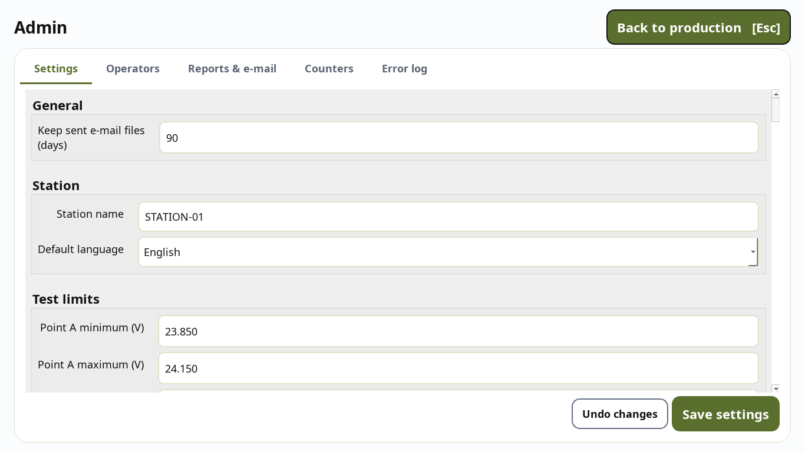
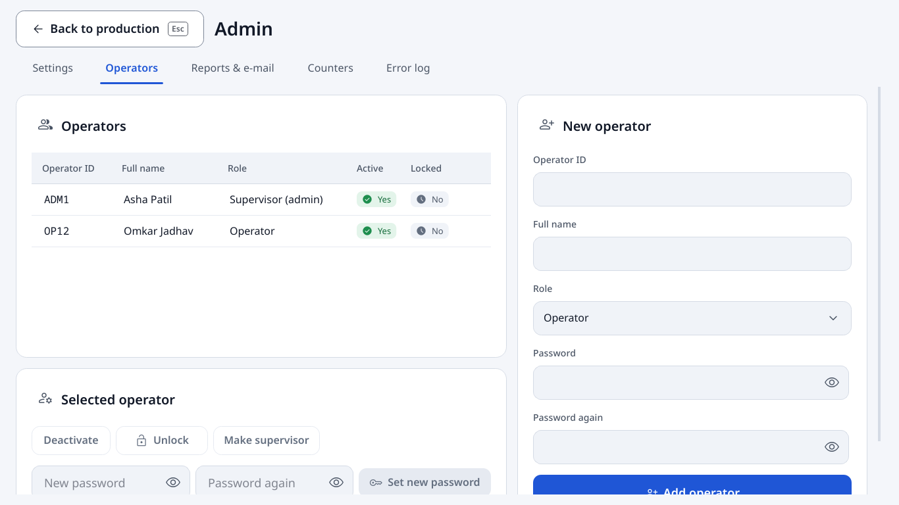
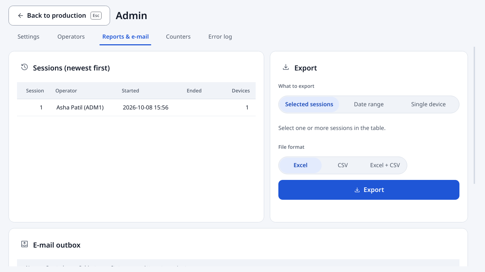

# Admin guide - Parkomate Station

For supervisors / administrators. Operators use the [operator guide](OPERATOR_GUIDE.md).

## 1. Install and first start

1. Run `ParkomateStation-Setup-<version>.exe` (built with `packaging\build.ps1`). It asks for
   this PC's **station name** (every PC a different one, e.g. `STATION-02`) and the **measuring
   device address** (its IP, or the Wi-Fi network like `192.168.1.0/24`), opens TCP port 8765
   in the Windows firewall and adds Start-menu shortcuts. (Developers: `uv sync`, see README.)
2. Create the first administrator **once** (the Setup offers it at the end), or in a command
   window:
   ```
   parkomate admin create
   ```
   (asks for operator ID, full name, password twice). Refused if an admin already exists.
3. Check the PC: Start menu **Parkomate Station - check this PC** (`parkomate doctor`). Every
   line must be OK or WARN - a FAIL says what to fix.
4. Start the station, log in with that admin, open **Admin** (click your initials, top right)
   and add operators. Then set up e-mail and press **Send test e-mail** (below).

Data folder: `C:\ProgramData\Parkomate`

| Item | What |
|---|---|
| `settings.toml` | station settings (edit in **Admin → Settings**) |
| `parkomate.db` | all production data (SQLite) - back it up with the PC backup |
| `reports\` | Excel / CSV report of every session |
| `outbox\` | e-mails waiting to be sent (`.eml`), kept after sending for `retention_days` |
| `logs\app.log`, `logs\errors.jsonl` | logs; errors are also visible in **Admin → Error log** |
| `backups\` | automatic database copy before a software update changes the database |

Windows users of the bench PC need **modify** rights on this folder (the installer sets it).

## 2. Admin area

Click your initials (top right) → **Admin**. It is only shown to supervisors and only enabled
when no board is in progress (the menu says why otherwise). **Back to production** (or
**Esc**) returns.

Settings: the list on the left jumps to a section; changed fields get a blue dot and the bar at
the bottom counts the unsaved changes; **Undo changes** reloads, **Save settings** checks every
value first (a wrong value turns red and says why; nothing is saved until all are valid).



### Settings
* Every field is checked when you press **Save settings**; a wrong field turns red with the
  reason under it, and nothing is saved until all are valid.
* Each saved change is written to the audit log (who, when, old → new value).
* **Test limits** are inclusive (`minimum ≤ value ≤ maximum`), compared after rounding to
  *Decimals used for comparison* (default 2).
* **Passwords and tokens** never go into the settings file. Use the *Passwords and tokens*
  box: pick the entry (SMTP password, OAuth token, API token), type the value, **Store in
  Credential Manager**. Or on the command line: `python -m parkomate secrets set smtp_password`.
* Settings saved here lose the comments of the file; every key is documented in
  `config/settings.example.toml`.

### Operators


* **Add operator**: ID (letters, digits, `- _ .`), full name, role, password twice
  (minimum length in *Login security*).
* Select a row to **Deactivate / Activate**, **Unlock** (after 5 wrong passwords),
  **Make supervisor / Make operator**, or **Set new password**.
* The last active supervisor cannot be deactivated or demoted.
* Forgot the only admin password? `python -m parkomate admin reset-password <ID>`.

### Reports & e-mail


* **Export** card: choose *What to export* (selected sessions / a date range from the calendar /
  a single device by ID or MAC) and the *File format* (Excel / CSV / Excel + CSV), then press
  **Export**.
* Sheets: **Summary** (one column per session), **Devices** (one row per board, every check
  value + PASS/FAIL + limits), **Checks** (every single result, including each upload
  attempt), **Rejections** (stage, box, check, value, limits, reason).
* **E-mail outbox**: each session report is queued first, then sent. Failures are retried
  automatically (1 min, 2 min, 4 min … max 1 h; at start-up and every 5 minutes). After
  *Give up after attempts* the status becomes **Failed** - fix the e-mail settings and press
  **Resend selected**. **Send waiting e-mails now** forces a try.

### E-mail set-up
In *Report e-mail*: switch on, recipients (comma separated), sender, SMTP server and port.
* Microsoft 365: `smtp.office365.com`, port 587, `starttls`. Microsoft switches off password
  (basic) SMTP sign-in by default from **end of December 2026** - plan `oauth2` (see
  DECISIONS M6; token set-up comes with the full build).
* Gmail: `smtp.gmail.com`, 587, `starttls`, an **app password** (Google account → Security →
  2-Step Verification on → App passwords). Store it under *Passwords and tokens* as
  `smtp_password`.
* Press **Reports & e-mail → Send test e-mail**: it is sent at once (not queued) and the message
  says why when it fails.
* Internal relay without sign-in: security `none` (the password is then never sent).

### Measuring device (Wi-Fi / LAN)
* The device and the station PC must be on the same network. The device POSTs its JSON to
  `http://<station PC>:8765/measurement`; `parkomate doctor` and the Testing screen (while it
  waits) show this address.
* **Measuring device IP (or network)**: the device's fixed address, or the whole network
  (`192.168.1.0/24`) when the router gives it changing addresses. The station PC itself is
  always allowed.
* **Refuse data for other stations** (on by default): with several stations on one Wi-Fi, a
  packet whose `station` field names another station is refused - set the device's station
  name to this PC's station name.
* Test without the device: `parkomate measuring-device --to <station IP>` from any PC on the
  network (**Enter** = good values, **1-4** = one value out of limits).

### Repair tab
Every rejected board opens a repair case. Anyone logged in can repair: top bar
**Production | Repair** → choose the board → write the repair → **Test again** (the whole line
again; the station checks the MAC) → **Accept board** after a passed retest, or **Scrap board**
with a reason. A failed retest puts the board back as *Needs repair*. Each step is stored with
the person and the session, and appears in the session report (**Repairs** sheet). Cases are per
PC: the list shows the boards rejected on this station.

### Counters
Live counters of the current session as tiles. **Reset counters** (only here, no longer on the
Programming screen) restarts them from zero after an inline confirmation; the history and the
session report still contain everything. Audited.

### Error log
Last 200 errors, newest first, filter by error code, click a row for details (no passwords
or firmware are ever logged).

## 3. Things to know

* **Remove 1 failure**: after a failed upload and a successful retry the operator may remove
  that one failure from the count - once per board, recorded in the audit log.
* **Crash / power cut**: at the next start the unfinished board is marked *abandoned*, the
  session is closed and its report queued; the login screen tells the operator. A retest that
  was running goes back to *Repaired* on the Repair tab.
* **Updates**: run the new Setup over the old one. Settings, database and reports in
  `C:\ProgramData\Parkomate` are kept; the database is backed up to `backups\` before it is
  upgraded.
* **Only one station window** can run per PC.
* **Simulated bench**: an amber band across the top and an amber **Simulation mode** chip (the
  scenario is in its tooltip) while mock hardware is in use (`dev.use_mock_hardware`). Never use
  it for real production.
* **Reduce motion**: *Screen → Reduce motion* switches the animations off (they are also off
  when Windows has animations switched off).
