# Multi-worker production line - architecture, workflow and plan

Status: **proposal** (nothing implemented yet). Owner of the proposal: Piyush (workflow).
Decisions that need the client or the team are collected in [section 12](#12-open-questions).

## 1. What we want

| # | Scenario | Example |
|---|---|---|
| S1 | **Several workers work together** on the same production run | Worker 1 programs, worker 2 tests, worker 3 labels - at the same time |
| S2 | **Batch work** - one worker does one step for many boards, then the next step for all of them | Code insertion (labeling step 1) for 40 boards, then casing (step 2) for the same 40 |
| S3 | **Production line** - one person per step, every product passes every person | Person 1 does labeling step 1 for every board, person 2 does step 2 for every board |
| S4 | **Flexible per board** - a worker takes a board through all steps, or stops after a few and finishes the remaining steps later (or someone else does) | Worker 1 does A and B on 10 boards before lunch and C-1 to D after lunch |
| S0 | Today's flow keeps working | One worker, one bench, one board from A to D in one go |

## 2. Why today's code cannot do it

Today a board is **owned by one session** (one operator at one PC) from `start_device` until
it is complete or rejected, and its progress lives **only in memory**.

| Blocker | Where |
|---|---|
| One in-progress device per session (unique index) | [0001_initial.sql:71](../src/parkomate/data/migrations/0001_initial.sql:71) `ux_devices_one_active` |
| A device can only be written by the session that started it | [records.py:214](../src/parkomate/data/records.py:214) `_require_in_progress`, [records.py:334](../src/parkomate/data/records.py:334) `record_transition` |
| Device progress (attempts, readings, ticks, QR, identity) is in RAM only - another session or PC cannot continue it | [engine.py:115](../src/parkomate/workflow/engine.py:115) `self._active` |
| Ending a session **abandons** every unfinished board | [records.py:134](../src/parkomate/data/records.py:134) `end_session` |
| Crash recovery **abandons** unfinished boards | [recovery.py:40](../src/parkomate/data/recovery.py:40) |
| The smallest unit of work is a whole stage (C = QR + ID write + 4 ticks) | [engine.py:172](../src/parkomate/workflow/engine.py:172) `required_checks` |
| Every session loads firmware and measures ambient, even at a station that only labels | [station.py:336](../src/parkomate/ui/viewmodels/station.py:336) `_enter_production` |
| Reports select devices by the session that *started* them | [reports/data.py:64](../src/parkomate/reports/data.py:64) |
| SQLite lives on one PC - several PCs cannot share it (WAL does not work over network shares) | D1, D4 in `DECISIONS.md` |

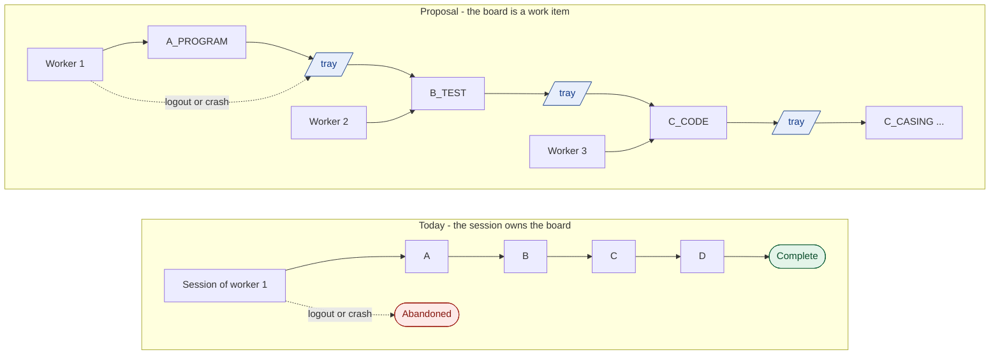

## 3. Core idea: operations and work in progress (WIP)

1. **Operation** = the smallest piece of work one worker does on one board in one sitting.
   Every stage is split into one or more operations, in a fixed line order.
2. **A board is a work item.** Its progress is stored in the database (`devices.next_op` +
   its full check history), not in the memory of one session. **Any** worker at **any** station
   can continue it.
3. **Claim / release.** A worker *claims* a board for one operation (an `operation_run`). While
   claimed nobody else can touch it. Finishing the operation releases it to the queue
   (tray) of the next operation. Logout or a crash *releases* the board - it is never lost.
4. **The worker chooses how far to go.** A station is configured with the operations its bench
   *can* do (`station.operations`). At login the worker ticks the steps they want to do now
   (default: all of them). A board moves on to the next step on the same bench while that
   step is ticked, and goes to a tray when it is not. **Finish later** stops a board at any
   time: every step already passed is kept and the board waits for its next step.
   **Default = all steps ticked = exactly today's behaviour (S0).**
5. **Pick up any board.** Plugging in a new board starts it at A. Plugging in or scanning an
   unfinished board continues it at its next step, whoever did the earlier steps and however
   long ago. The step screen shows what was already done, by whom and when.
6. **Mix-up guard.** When a board is picked up, the station identifies it (MAC over serial, or
   QR scan) and refuses it if its next step is not possible at this bench - a board can never
   skip a step, even when trays get mixed. If the bench can do the step but the worker did not
   tick it, the station offers "Add this step" or "Put in tray".

### 3.1 Operation catalogue (proposed default - confirm the labeling split with the client)

| Op code | Stage | Operator sees | Checks | Board identified by | Bench needs |
|---|---|---|---|---|---|
| `A_PROGRAM` | A | Programming | `A_WHITELIST`, `A_UPLOAD` | MAC (new board) | serial, server |
| `B_TEST` | B | Testing | `B1_COMM`, `B2_READING_1..N`, `B2_SENSOR_OK`, `B2_INDICATOR_OK`, `B3_*` | MAC | serial, measuring device |
| `C_CODE` | C | **C-1 Code insertion** | `C_QR_READ`, `C_ID_SYNC`, `C4` QR sticker applied | MAC | serial, camera |
| `C_CASING` | C | **C-2 Casing** | `C1` PCB fitted in casing, `C2` screws fitted | QR | camera (or hand scanner) |
| `C_BRANDING` | C | **C-3 Branding** | `C3` branding sticker applied | QR | camera (or hand scanner) |
| `D_PACK` | D | Packaging | `D1`-`D4` | QR | camera (or hand scanner) |

* The catalogue is data in code (`workflow/operations.py`), like the transition table. Testing
  could later be split into `B_FUNCTION` + `B_ELECTRICAL` without changing anything else.
* A stage is complete when all its operations passed; the stage transition (A→B, ..., D→COMPLETE)
  is recorded at the end of its last operation. Reject boxes stay **A-D** per stage.
* The stage gates stay exactly as today - they are only spread over several operations.

### 3.2 Line view

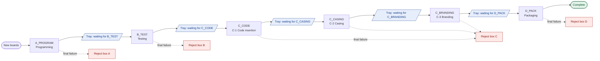

### 3.3 Ways to run it - same software, the worker ticks the steps

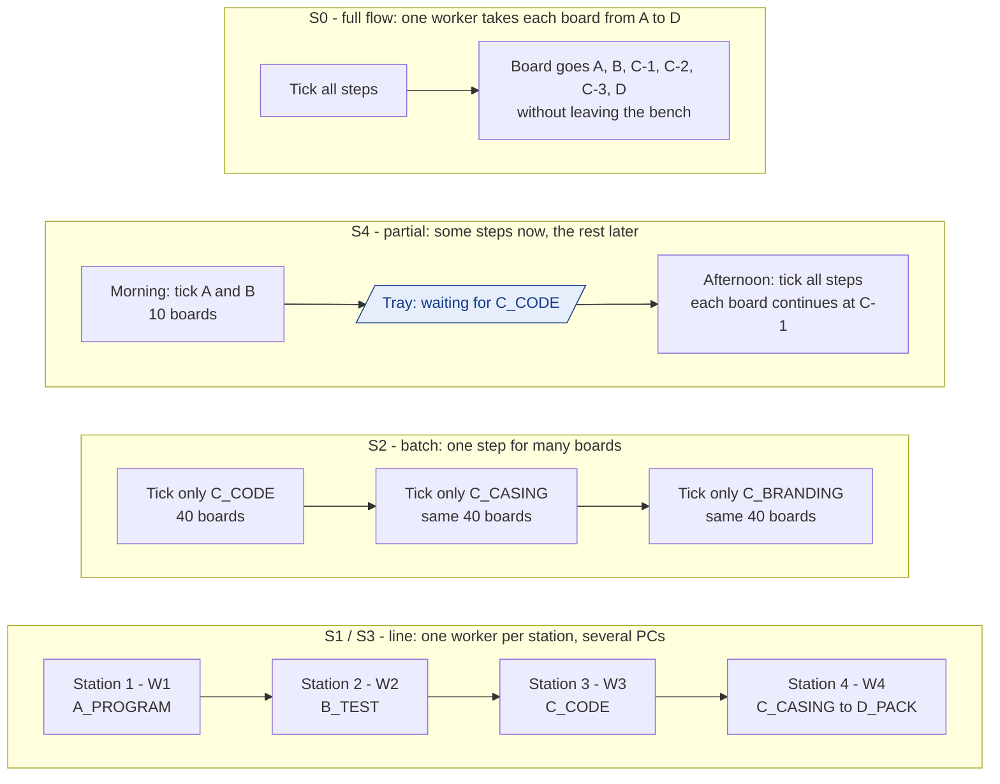

In every mode the worker can also press **Finish later** on any board; it waits in the tray for
its next step and anyone can continue it.

## 4. Board lifecycle

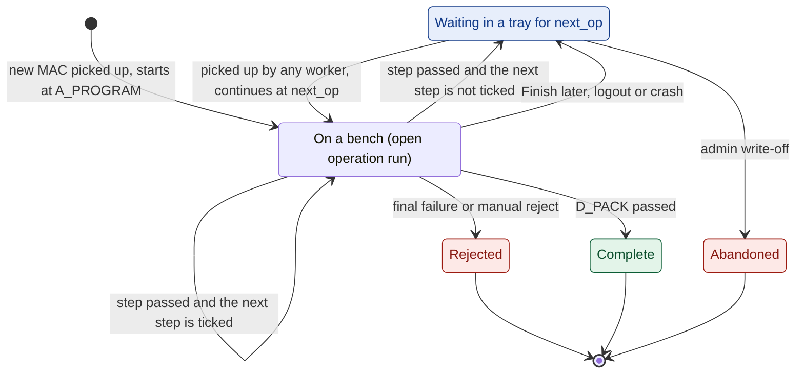

Rules

* **One open run per board and one per session** (unique partial indexes) - two workers can
  never work on the same board, and one worker never holds two boards.
* **Resuming a board** rebuilds the engine state from the database: gate results come from the
  *passed* runs of earlier operations plus the current run; results of a *released* run stay in
  the history but do not count (the operation starts again). **Attempt counts span all runs**,
  so releasing and re-claiming can never reset the upload retry limit (W1, W2).
* **Finish later between two steps loses nothing.** In the middle of a step it first asks for
  an inline confirmation ("C-1 is not finished - it starts again next time"), then closes the
  run as released.
* `abandoned` is no longer automatic. Logout and crash release; only an admin writes a board off.

## 5. Architecture

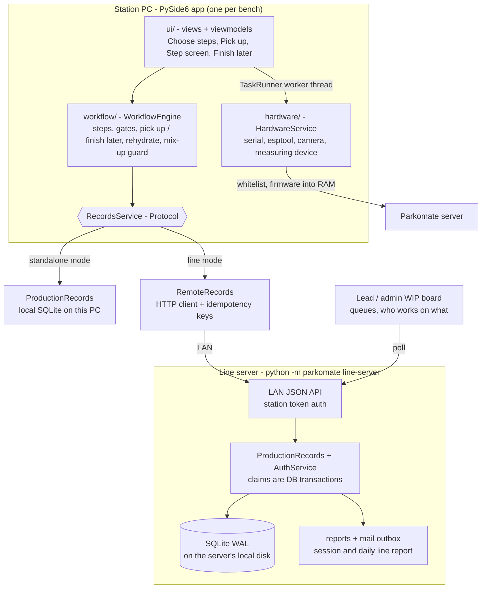

Key points

* **One boundary decides standalone vs line.** The engine depends on a `RecordsService`
  Protocol (the methods of `ProductionRecords` it uses today plus the WIP methods). Local
  SQLite implements it for one PC; an HTTP client implements it for a line. The engine, the
  gates and the UI are identical in both modes.
* **Why a line server and not a shared database file:** SQLite over SMB/network shares
  corrupts (no reliable locking, WAL unsupported). One process owning the database on its local
  disk keeps every guarantee we have today (WAL, FK, append-only triggers, migrations, backups).
  PostgreSQL can replace SQLite behind the same server later without touching stations.
* **Firmware rule unchanged:** each programming station fetches the BIN from the Parkomate
  server into RAM. Firmware never passes through the line server.
* **Operators are central** in line mode (auth runs on the server), so a worker can log in at
  any station.
* Phase 1 builds everything **except** the line server: it delivers S0, S2, S4 and handover between
  workers on one PC. Phase 2 adds the server for S1/S3 across PCs.

## 6. Data model (migration `0004_operations.sql`)

`origin/main` already has `0003_repairs.sql`, so this is `0004`.

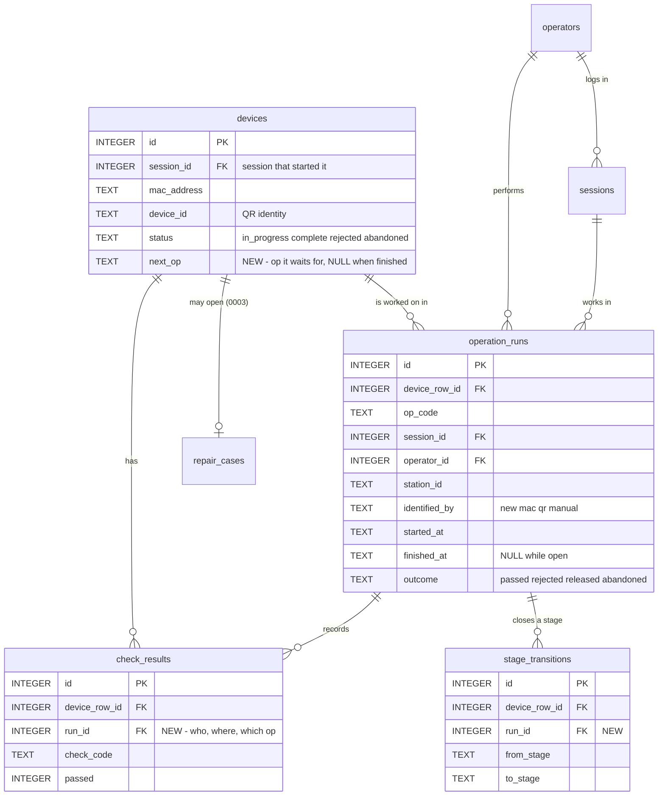

Sketch:

```sql
-- 0004_operations: boards flow through operations; any session may continue a board.
DROP INDEX ux_devices_one_active;                 -- a session now leaves many boards in WIP
ALTER TABLE devices ADD COLUMN next_op TEXT;      -- NULL once complete / rejected / abandoned
CREATE INDEX ix_devices_queue ON devices (next_op, id) WHERE status = 'in_progress';

CREATE TABLE operation_runs (
    id            INTEGER PRIMARY KEY,
    device_row_id INTEGER NOT NULL REFERENCES devices (id),
    op_code       TEXT    NOT NULL,
    session_id    INTEGER NOT NULL REFERENCES sessions (id),
    operator_id   INTEGER NOT NULL REFERENCES operators (id),
    station_id    TEXT    NOT NULL,
    identified_by TEXT    NOT NULL CHECK (identified_by IN ('new', 'mac', 'qr', 'manual')),
    started_at    TEXT    NOT NULL,
    finished_at   TEXT,
    outcome       TEXT CHECK (outcome IN ('passed', 'rejected', 'released', 'abandoned')),
    CHECK ((finished_at IS NULL) = (outcome IS NULL))
);
CREATE UNIQUE INDEX ux_runs_open_device  ON operation_runs (device_row_id) WHERE finished_at IS NULL;
CREATE UNIQUE INDEX ux_runs_open_session ON operation_runs (session_id)    WHERE finished_at IS NULL;
-- append-only except closing an open run exactly once (trigger), never deleted (trigger)

ALTER TABLE check_results     ADD COLUMN run_id INTEGER REFERENCES operation_runs (id);
ALTER TABLE stage_transitions ADD COLUMN run_id INTEGER REFERENCES operation_runs (id);
-- back-fill next_op of in-progress rows from their last stage transition
```

Counters are unchanged: `counter_events` already carry `session_id` + `operator_id`, so upload
counts stay per session and are still computed from events.

## 7. Contract changes (WorkflowService, Piyush)

To be listed at the top of `DECISIONS.md` when implemented.

```python
class OpCode(StrEnum):            # core/enums.py (shared type)
    A_PROGRAM, B_TEST, C_CODE, C_CASING, C_BRANDING, D_PACK

operations() -> list[Operation]                  # ops this bench can do, in line order
choose_steps(ops: set[OpCode]) -> None           # steps the worker does now (default: all of them)
queue(op) -> list[WorkItem]                      # boards waiting for op, oldest first
pick_up(key: DeviceKey) -> DeviceState           # key = MAC or QR; new MAC starts at A,
                                                 # an unfinished board continues at next_op
finish_later() -> None                           # board waits for its next step; a half-done
                                                 # step is released and starts again
add_step(op) -> None                             # "Add this step" from the mix-up message
current_operation() -> OpCode | None
required_checks(op) -> list[CheckCode]           # was: per stage
submit_and_next() -> StepResult                  # was: -> Stage
start_device(mac)                                # kept = pick_up(MAC) of a new board
```

* `StepResult(stage, next_op, parked, complete)` - `parked=True` means "put the board in the
  tray for `next_op`" (the next step is not ticked); otherwise the same board continues.
* `submit_check` refuses a check that is not part of the current operation.
* New error codes (+ `error.<code>.title/cause/action` in EN and MR):
  `WIP_STEP_NOT_SELECTED` (the bench can do the next step, the worker did not tick it - offers
  "Add this step"),
  `WIP_WRONG_OPERATION` (this bench cannot do the board's next step - message names the tray),
  `WIP_CLAIMED` (being worked on at station X by Y), `WIP_FINISHED` (already complete /
  rejected - names the reject box), `WIP_NOT_FOUND`, `LINE_OFFLINE`, `LINE_AUTH`.
* New events: `OperationStarted`, `OperationFinished`, `DevicePutInTray`.
* `HardwareService` needs **no new methods** (`read_mac`, `read_qr` cover identification).
  It must start with partial hardware (a packaging station has no serial bridge or measuring
  device).

## 8. Workflows

### 8.1 Partial work (S4) - some steps now, the remaining steps later

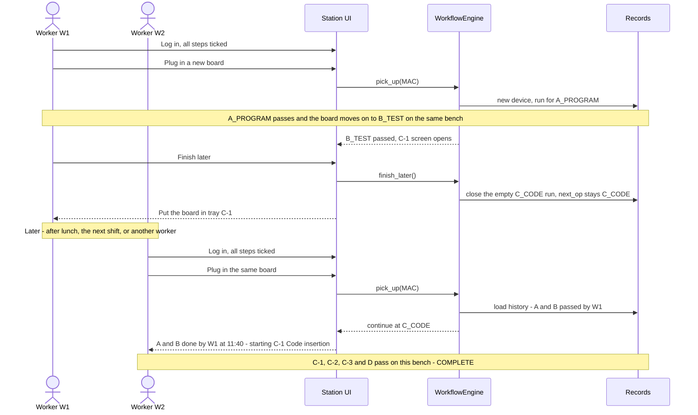

The same works without logging out: W1 can tick only A and B for the morning, and every board
goes to tray C-1 by itself after B (see S4 in section 3.3).

### 8.2 Batch mode on one PC (S2) - code insertion for a whole tray, then casing

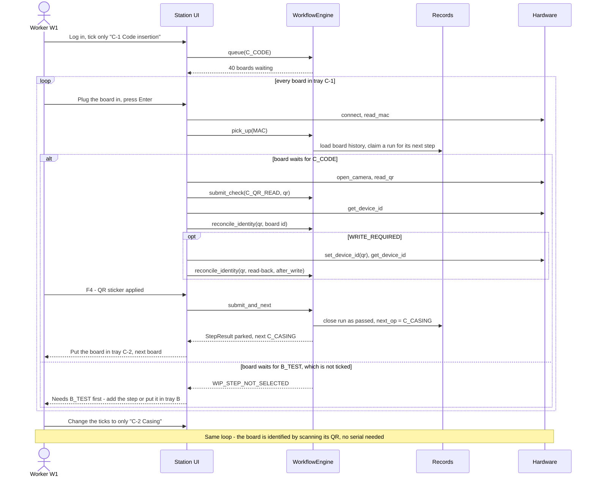

### 8.3 Line across PCs (S1 / S3) - claim, hand-over and the double-claim guard

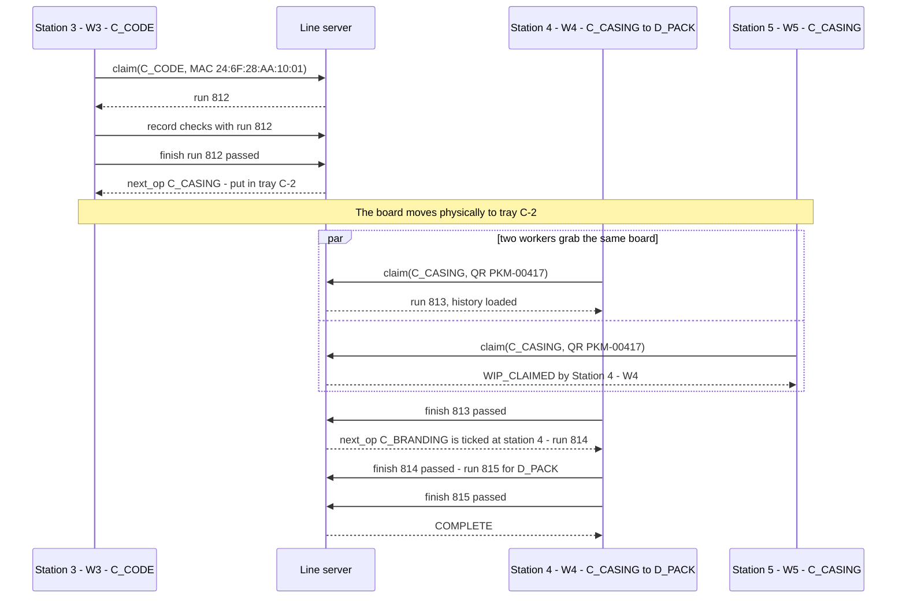

### 8.4 Finish later, logout and crash

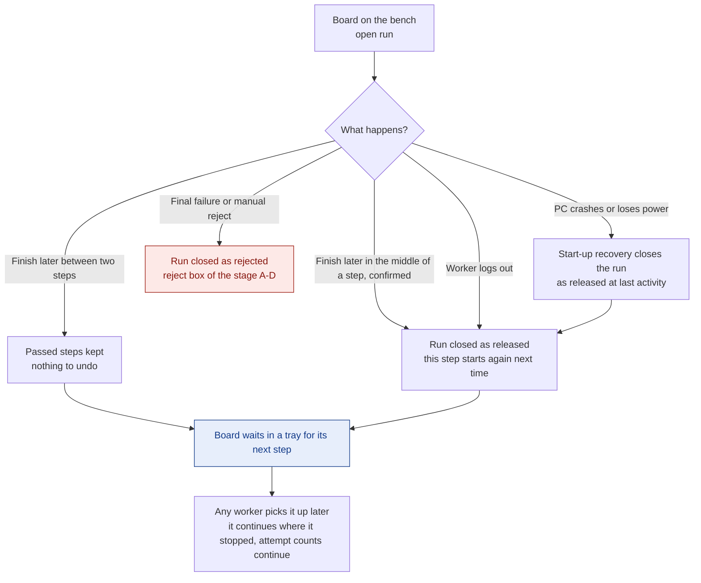

## 9. UI changes (Yugant)

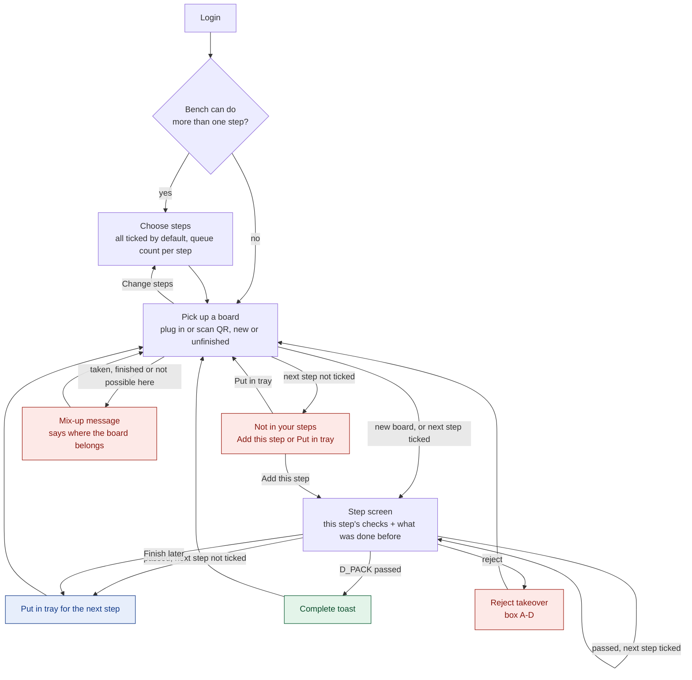

* **Choose steps** after login: one row per step this bench can do, all ticked by default,
  with the number of boards waiting. "Change steps" is always one tap away.
* **Finish later**: a secondary button on every step screen (one primary button stays
  bottom-right). Between steps it parks the board at once; mid-step it asks inline first.
* Stepper shows operations inside stages (`A · B · C-1 C-2 C-3 · D`) with the board's progress:
  passed steps show who did them and when.
* Labeling card shows only the sections of the current op (code insertion *or* checklist rows).
* "Put in tray" takeover: large, one primary button, like the reject takeover but neutral.
* Side drawer: "This session: 28 × C-1 done, 1 rejected", plus **My unfinished boards** (boards
  this worker stopped, with their next step); queue counts refresh live.
* Session start loads firmware **only** when the station does `A_PROGRAM` and measures ambient
  **only** when it does `B_TEST`.
* Admin: the steps this bench can do, "write off board" (audited).
* Every new string in `en.json` **and** `mr.json`, new Marathi listed in `i18n/REVIEW.md`.

## 10. Settings

```toml
[station]
station_id = "STATION-03"
operations = ["C_CODE", "C_CASING", "C_BRANDING", "D_PACK"]
                                 # steps this bench CAN do (default: all six)
                                 # the worker ticks which of them to do at login

[line]                           # phase 2
mode = "standalone"              # "standalone" (local SQLite) or "client" (line server)
server_url = "http://line-server:8780"
token_ref = "line_station_token" # secret in the OS keyring, as always
```

## 11. Plan

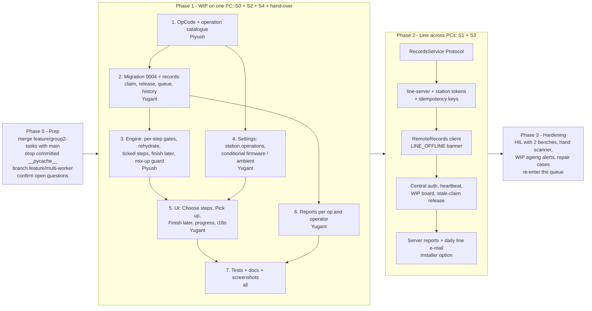

### Phase 1 - work in progress on one PC

| # | Task | Owner | Done when |
|---|---|---|---|
| 1 | `OpCode` in `core/enums.py`; `workflow/operations.py` catalogue (stage, checks, identify-by, bench needs, line order) | Piyush | catalogue unit-tested; every `CheckCode` belongs to exactly one op |
| 2 | `0004_operations.sql`; `runs` repository; records: `claim_run`, `finish_run`, `release_open_run`, `queue`, `device_history`, `find_device(mac / qr)`; `end_session` and recovery **release** instead of abandon | Yugant | migration test on a 0003 DB; append-only trigger tests |
| 3 | Engine: state rebuilt from history, per-op `required_checks` / `missing_checks`, `choose_steps`, `pick_up`, `finish_later`, `add_step`, `submit_and_next -> StepResult`, mix-up guard, attempts across runs | Piyush | engine tests below pass; old `test_workflow_engine.py` still green |
| 4 | Settings `station.operations`; firmware / ambient only when needed; `create_hardware` tolerant of missing devices | Yugant, Aditya | settings validation + mock bench with "C-only" station |
| 5 | UI: Choose steps, Pick up, Finish later, Put in tray, "Not in your steps", op-filtered labeling card, stepper with progress, My unfinished boards, admin write-off; EN + MR | Yugant | `tests/ui` flows for full, partial and batch work; static i18n scan green; screenshots |
| 6 | Reports: runs per op / operator / station; session report lists boards *touched* in the session | Yugant | report tests |
| 7 | `CONTRACTS.md`, `DECISIONS.md` (contract changes on top), `OPERATOR_GUIDE.md`, `ADMIN_GUIDE.md` | all | reviewed |

### Phase 2 - line across PCs

| # | Task | Done when |
|---|---|---|
| 1 | `RecordsService` Protocol; engine depends only on it | engine tests run against both implementations |
| 2 | `python -m parkomate line-server` (FastAPI + uvicorn, pydantic models reused) wrapping `ProductionRecords` + `AuthService`; station tokens in keyring; idempotency key on every write | API tests |
| 3 | `RemoteRecords` client, `[line]` settings, `LINE_OFFLINE` banner with retry | station runs on mocks against an in-process server |
| 4 | Central operators, station heartbeat, WIP board for lead/admin, admin "release stale claim" | two-station race test: exactly one claim wins |
| 5 | Server-side session report + daily line report e-mail; installer option "line server" (Windows service + firewall rule) | installed on a test PC |

### Tests that prove it

* Full flow: all steps ticked → one board goes A to D on one bench, same records as today.
* Partial: worker 1 ticks A and B, does 5 boards, logs out; worker 2 picks each one up and it
  continues at C-1; reports credit A/B to worker 1 and C/D to worker 2.
* Finish later mid-step: QR scanned in C-1, Finish later confirmed → next pick-up starts C-1 again.
* Batch: 10 boards through `C_CODE`, then the same 10 through `C_CASING` → all reach `C_BRANDING`.
* Hand-over: worker 1 logs out with boards in trays, worker 2 logs in on the same PC and completes them; each run is attributed to the right operator.
* Mix-up: a board waiting for `B_TEST` scanned at `C_CODE` → `WIP_WRONG_OPERATION`, nothing recorded except an audit entry.
* Release: a run released after 3 of 5 readings → re-claim needs all 5 again; upload attempts are **not** reset.
* Crash: open run at start-up → released, board back in its queue, login screen says so.
* Default settings: the existing end-to-end and UI flow tests pass unchanged (S0).
* Phase 2: two clients claim the same board at once → one `WIP_CLAIMED`; a retried write with the same idempotency key is stored once.
* Firmware: the existing data-folder scan for the BIN still passes with several stations.

## 12. Open questions

| # | Question | Default if no answer |
|---|---|---|
| 1 | One PC with workers taking turns, or several PCs along a line? | Phase 1 first (one PC); line server in phase 2 |
| 2 | Exact labeling split and physical order - is the QR still visible after casing? | C-1 code + QR sticker, C-2 casing, C-3 branding |
| 3 | Split testing into functional and electrical operations? | No - `B_TEST` stays one op |
| 4 | QR stations: webcam or USB hand scanner (much faster for batch work)? | Webcam; hand scanner works as keyboard input later |
| 5 | Where does the line server run - one station PC or a separate mini PC? | Separate PC (a station reboot must not stop the line) |
| 6 | A MAC that is already complete is plugged in at A again (open question 10) | Refuse with "already completed on <date>" |
| 7 | Reports: per session as today, plus one line report per shift / day? FPY is a line metric once boards span sessions | Session report + daily line report |
| 8 | Who owns the line-server package (`src/parkomate/line/`)? | Yugant (data) with Piyush (claims) |
| 9 | How long may a board wait in a tray before an alert? | No alert in phase 1 |
| 10 | May a worker stop in the middle of a step, or only between steps? | Both; mid-step asks first and the step starts again |
