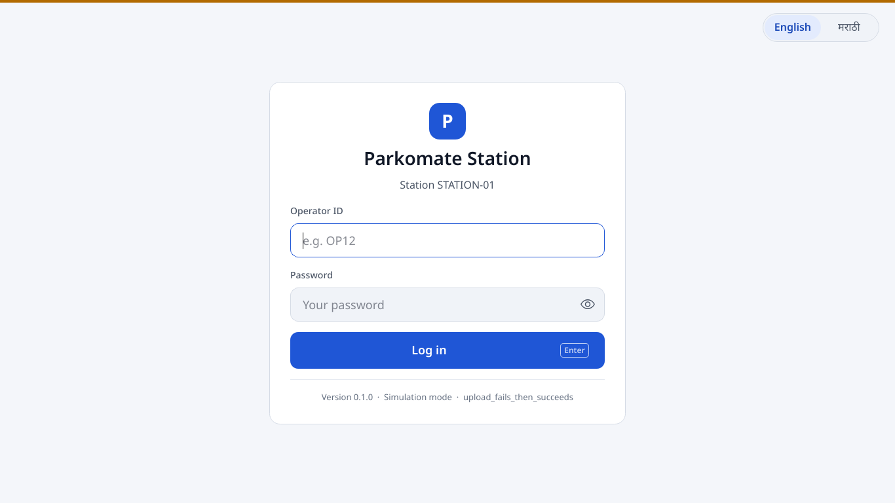
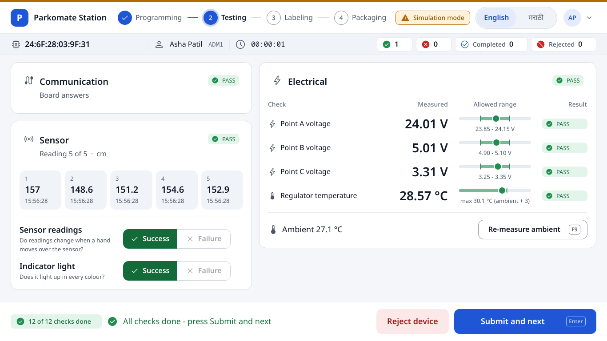
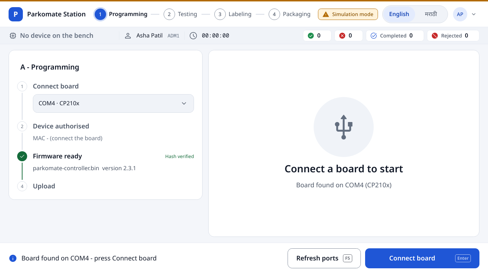
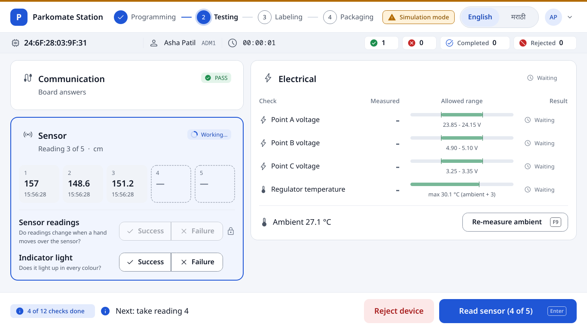
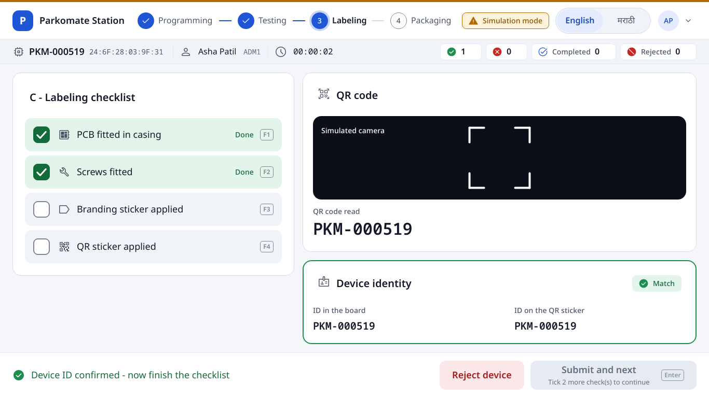
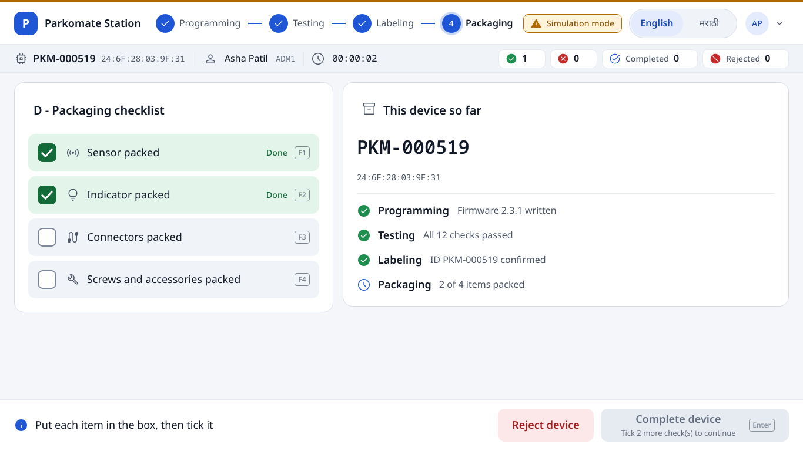
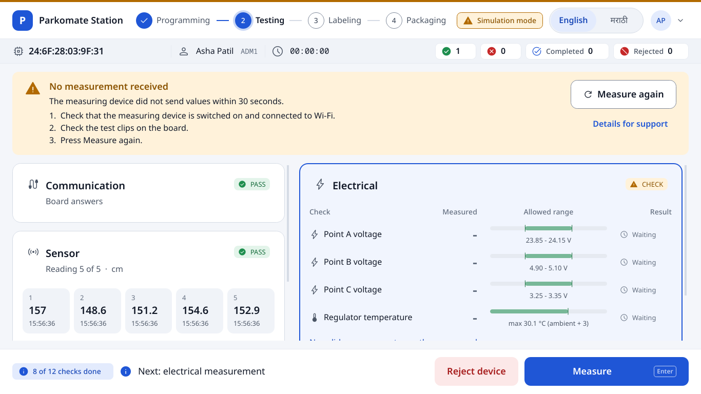

# Operator guide - Parkomate Station

One board at a time. Follow the screen. **The big blue button at the bottom-right is always
the next thing to do** - press it or press **Enter**.

The screen is also in Marathi: press **मराठी** at the top. The app remembers your choice.

---

## 1. Log in

1. Type your **Operator ID** and **Password**. Press **Enter**. The eye inside the password
   field shows what you typed. **English / मराठी** (top right) switches the language.
2. Wrong password 5 times → the account is locked for a few minutes. The screen tells you how
   long. Your supervisor can unlock it.
3. The station measures the room temperature. Wait for the green tick.

## 2. The screen

* **Top**: the four stages. The blue circle is where you are; a tick = done; a red cross =
  rejected. On the right: **English / मराठी** and your initials - click them for **Session
  details**, **Admin** (supervisors) and **Log out**. An amber band and a **Simulation mode**
  chip mean no real hardware is used.
* **Line below**: the board (ID big, MAC small), your name, session time, and the counters
  (uploads OK, uploads failed, completed, rejected).
* **Middle left**: the steps / checks. **Middle right**: live values and the result.
* **Bottom**: what to do next, and the **blue button** (the next action, **Enter**).
* A grey button says **why** it is not ready yet, inside the button
  (for example "Tick all 4 checks to continue").
* In Testing, a small chip counts the checks ("4 of 12 checks done").

## 3. A - Programming

1. Plug the board's USB cable. The port is chosen for you (shown as e.g. "COM4 · CP210x").
2. Press **Connect board** (Enter). The station checks the board with the server.
3. Press **Upload firmware** (Enter). Keep the cable in until 100 % - the big ring on the
   right shows the progress, the dots show the attempts.
4. If the upload fails, press **Retry upload**. If it then works, the station asks
   **"Remove 1 failure from count?"** - answer once.
5. Press **Submit and next**.

## 4. B - Testing

1. The communication test runs by itself.
2. Press **Read sensor** 5 times (Enter each time). The readings fill the five boxes in order.
3. Look at the board: do the readings change? Does the indicator light up?
   Press **Success** or **Failure** for each (a lock means "not yet - take the readings first").
4. The electrical measurement starts by itself. Every line must show **PASS**; the bar shows
   where the value sits inside the green allowed range.
5. Press **Submit and next**.

## 5. C - Labeling

1. Hold the QR sticker in the frame (a blue line scans; the frame flashes green when read).
   The ID is read and set in the board by itself - if the board had another ID, the screen
   shows **Before** (crossed out) → **Now**.
2. Do the 4 jobs and tick each row (click the row, or **F1 F2 F3 F4**).
3. Press **Submit and next**.

## 6. D - Packaging

1. Put each item in the box and tick it (**F1–F4**).
2. Press **Complete device**. A green bar says **"Device … complete"**.
3. Unplug the board, plug the next one, press **Connect board**.

## 7. RED screen = reject

1. Read the box letter (**A**, **B**, **C** or **D**).
2. Put the board in **that reject box**.
3. Press **Device placed in box** (Enter).

## 8. Something went wrong

Do the numbered steps, then press the button on the right (**Try again**, **Measure again**,
**Scan again** …). If it keeps happening, call the supervisor and show the screen.

## 9. End of shift

1. Click your initials (top right) → **Log out** (or **Session details** → **End session**),
   then **End session** again to confirm.
2. The summary shows your counts (devices, completed, rejected, first-pass yield, rejects per
   stage). The report is sent (or saved and sent later) - **Open folder** shows the file.
3. Press **Log out**.

**Esc** never deletes anything. If the station closes by accident, the board on the bench is
marked "not finished" - put it aside for re-testing and tell the supervisor.
