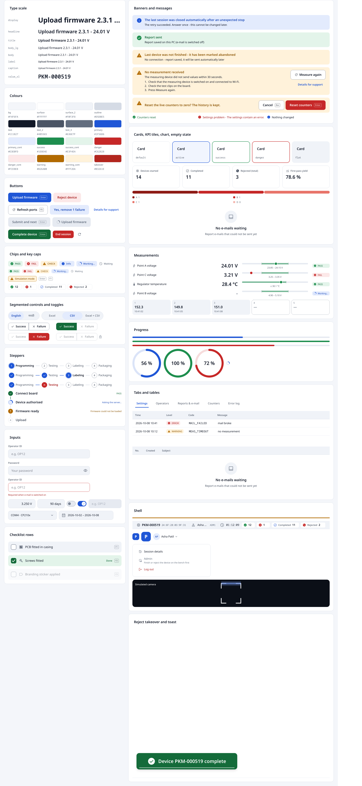
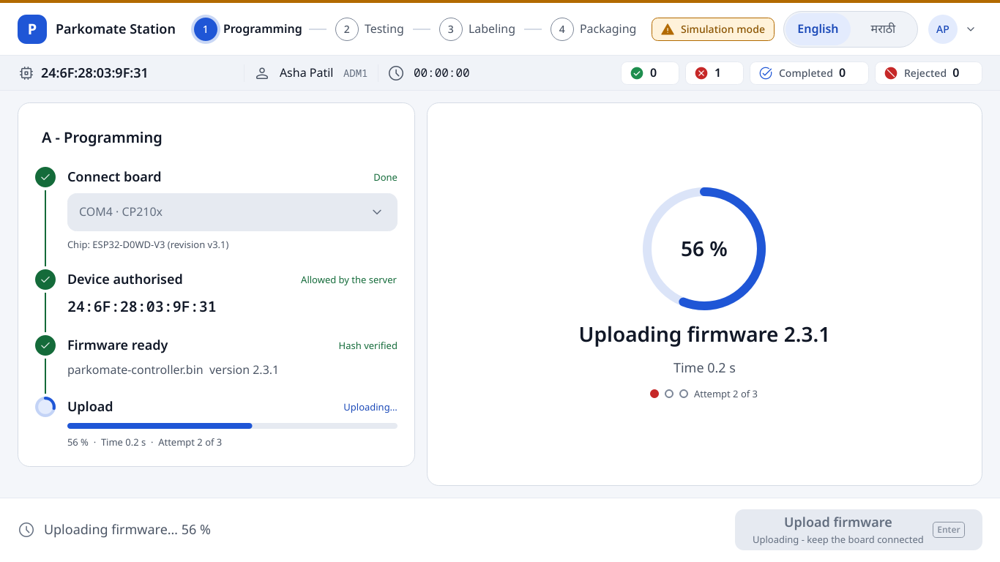
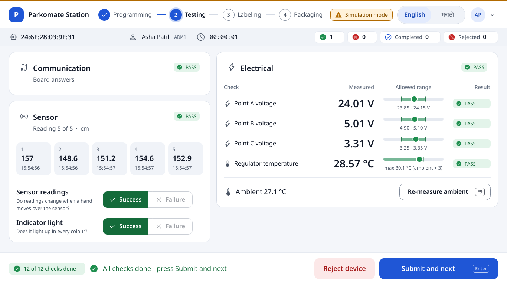
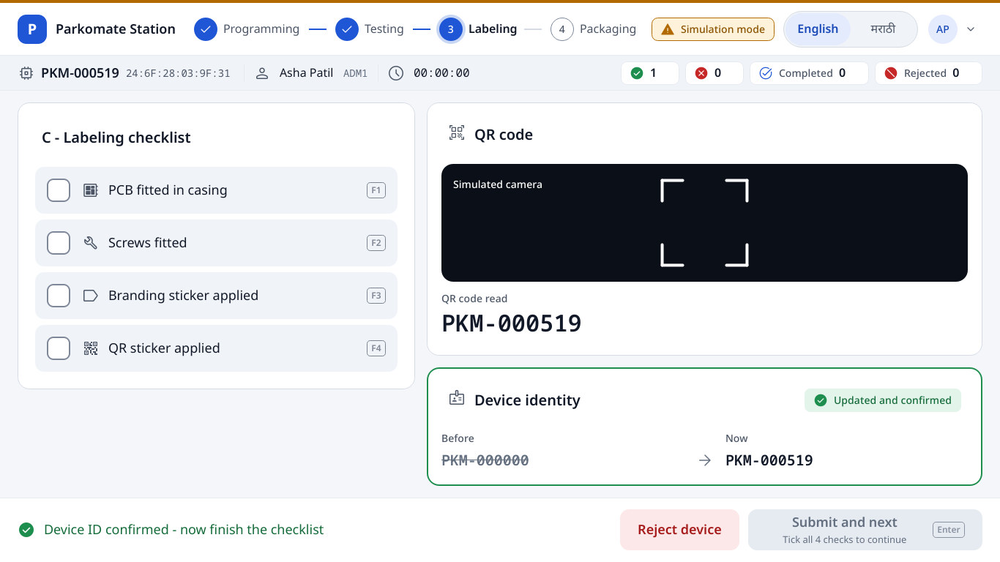
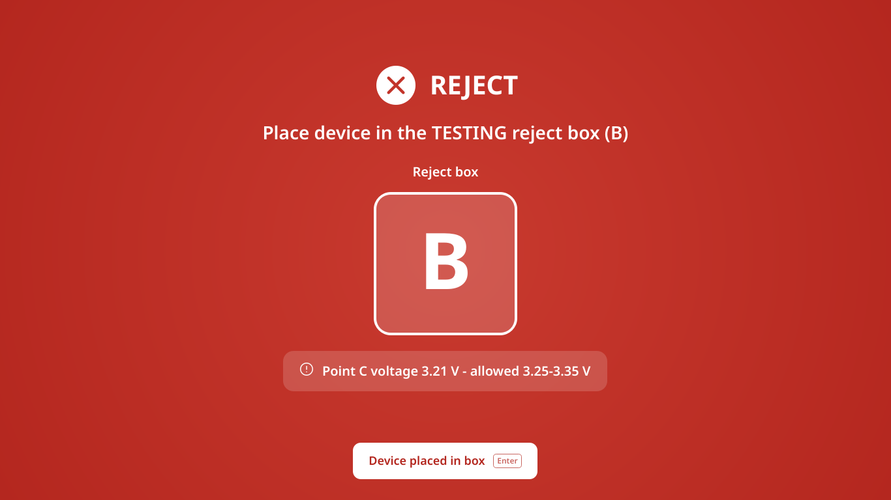
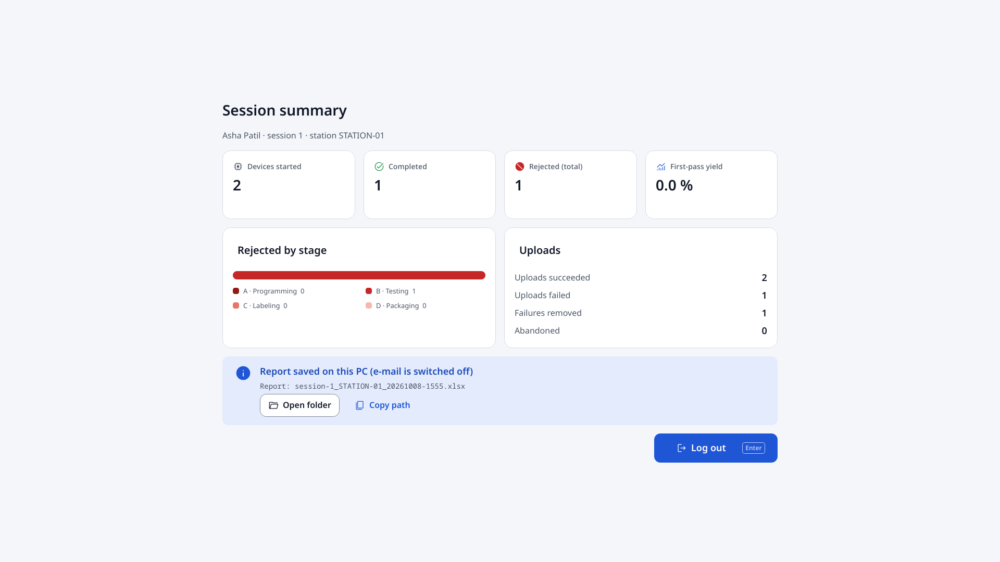
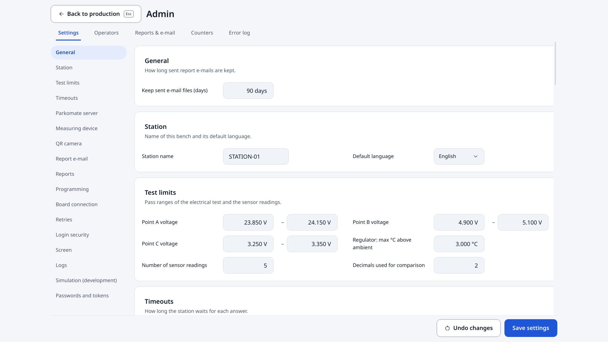

# Parkomate Station - design system

Calm, precise and legible from 1 m: Material 3 / One UI inspired, light theme (factory floors
are bright), one confident accent colour, glove-friendly sizes. Everything comes from
`src/parkomate/ui/theme/tokens.py`; nothing outside `ui/theme` may hard-code a colour or a
pixel size (`tests/ui/test_design_system.py` fails if it does).

Run the gallery yourself: `uv run python -m parkomate --gallery` (every component, every state,
with a live English / मराठी switch). `uv run python -m parkomate.ui.gallery --out docs/design`
renders `gallery_en.png` and `gallery_mr.png`.

## 1. Principles

1. **One thing stands out.** Body text is Regular; only titles and key values are bold. Each
   screen has exactly ONE filled (primary) button, bottom-right (tested).
2. **Status is never colour alone.** Icon + word + colour (PASS / FAIL chips, toggles, rows).
   Green, red and amber are reserved for status, never decoration.
3. **One level of card.** White cards on the tinted page, separated by 16 px of space - never
   a bordered card inside a bordered card. Inside a card, groups are separated by space or a
   soft divider.
4. **Quiet until it matters.** Pending steps are small and grey; only the active step and
   results carry colour.
5. **Switching language never moves anything.** Every text sits in a fixed line box with one
   baseline for Latin and Devanagari, and every translated label reserves the width (and, when
   it wraps, the line count) of its LONGEST translation (tested on every screen at 1366 x 768
   and 1920 x 1080).
6. **Nothing native leaks through.** No Windows combo arrows, spin buttons, scroll-bar arrows,
   group-box frames or table grids; Fusion + our own palette, whatever the OS colour scheme.

## 2. Colour

Light theme. Text/background pairs meet WCAG AA (4.5:1, tested pair by pair in
`tests/ui/test_static.py`); icons, control borders and the focus border meet 3:1.

| Token | Value | Use |
|---|---|---|
| `bg` | `#F4F6FA` | page background |
| `surface` | `#FFFFFF` | cards, popups, bars |
| `surface_2` | `#F0F3F8` | inset areas, table header, input fill, context bar |
| `surface_3` | `#E6EAF1` | hover on surface_2, disabled fill, tracks |
| `outline` | `#D5DBE5` | card / input borders (1 px) |
| `outline_soft` | `#E6EAF1` | dividers |
| `outline_strong` | `#7D8798` | unselected controls (3:1) |
| `text` | `#111827` | primary text |
| `text_2` | `#4B5565` | secondary text |
| `text_3` | `#636E7F` | captions, placeholders (spec `#7A8494` was 3.8:1 - darkened to pass AA) |
| `primary` | `#1F56D6` | THE action colour: filled buttons, active states, focus |
| `primary_hov` / `primary_pressed` | `#1A49B8` / `#163E9C` | hover / pressed |
| `primary_cont` / `on_primary_cont` | `#E3EBFD` / `#1A49B8` | tonal buttons, active card, selected thumb |
| `success` / `success_cont` / `on_success_cont` | `#1E8E4E` / `#E3F4EA` / `#146B3A` | PASS |
| `danger` / `danger_cont` / `on_danger_cont` | `#C62828` / `#FCE8E8` / `#A61B1B` | FAIL, reject |
| `warning` / `warning_cont` / `on_warning_cont` | `#B26A00` / `#FFF2DA` / `#8A5300` | warnings, simulation |
| `info` / `info_cont` / `on_info_cont` | `#1F56D6` / `#E3EBFD` / `#1A49B8` | information |
| `takeover` / `takeover_glow` | `#B3261E` / `#C93A2F` | reject takeover (radial lighter centre) |

**Status triplets.** `<x>` is for icons, bars and fills; `<x>_cont` is the container;
`on_<x>_cont` is text on the container (and on white) and the fill behind white text. The
spec's `#1E8E4E` and `#B26A00` are only 3.7:1 on their containers, so text uses the darker
`on_*` value (green filled buttons use `on_success_cont`, 6.6:1 with white).

**Rejects by stage** (stacked bar): `reject_a..d` = `#8E1B16 #C62828 #E8746A #F5B8B0` - a red
ramp, because all four are rejects; the legend always names the stage and the count.

## 3. Type

Noto Sans (Latin), Noto Sans Devanagari (Marathi), Noto Sans Mono (MAC, IDs, codes) - all
bundled, Regular / Medium / SemiBold / Bold so 400 / 500 / 600 / 700 are real faces. Tabular
figures (`tnum`) on every number.

| Style | Size / weight / line | Use |
|---|---|---|
| `display` | 40 / 700 / 60 | reject title, hero result |
| `headline` | 28 / 600 / 42 | screen titles, KPI values, measured values |
| `title` | 20 / 600 / 30 | card titles |
| `body_lg` | 18 / 400 / 26 | main body, checklist items |
| `body` | 16 / 400 / 24 | secondary body, table cells |
| `label` | 14 / 500 / 22 (+0.1 px) | field labels, chips, tabs |
| `caption` | 13 / 400 / 20 | hints, timestamps, footers |
| `value_xl` | 32 / 600 / 44, mono | device ID |
| `button` / `button_sm` | 18 / 600 / 26 · 16 / 600 / 24 | buttons |

**Line heights are the same in English and Marathi** (deliberate deviation from "Marathi +4 px":
that would move the layout on every language switch). They are the spec values, raised where
Noto Sans Devanagari needs the room (title 30, headline 42, display 60, label 22, caption 20),
so nothing clips. `Text` (a QLabel subclass) lays out lines itself on that fixed line box and
baseline; buttons, chips and tabs paint through `draw_line()` with the same baseline.

## 4. Space, shape, elevation, size

* Spacing scale: **4, 8, 12, 16, 24, 32, 48** - nothing else. Page margin 24 (32 from 1600 px
  wide); content max 1600 px, centred; gap between cards 16; card padding 24 (20 compact);
  label → control 8.
* Radius: chips 8, inputs / buttons 12, cards / camera 16, hero tiles 24, segmented / avatar pill.
* Elevation: none on cards (surface + 1 px outline). Only floating things - menus, popups, the
  toast, the drawer - get the one soft shadow (blur 24, y 8, 10 % black).
* Buttons 56 (compact 44), min width 120, padding 24, icon 20 + 8 gap. THE primary action is
  at least 320 wide. Inputs 52, padding 16. Checkbox 32, list rows 64, table rows 48, tabs 48.
* Shell: simulation band 4, app bar 72, context bar 48, action bar 88. 12-column grid, left
  5 / right 7 columns.

## 5. Motion

120 ms hover / press, 200 ms state changes, 280 ms enter / exit, OutCubic. Animated: stepper
line, chip / card state, checklist tick (draws itself), progress bar and ring, toast slide +
countdown line, takeover fade + one-time pulse of the box tile, new reading slide-in, tab
indicator, segmented thumb, switch thumb. Looping: only the camera scan line and the
"working" spinner (one shared 60 fps clock that runs only while something needs it).
**Reduced motion** (`[ui] reduce_motion = true`, or Windows animations switched off): every
animation jumps to its end, nothing loops.

## 6. Focus

ONE focus style: a 1 px primary border with a 3 px primary halo at 40 %, drawn by one overlay
per window around the focused control - only after keyboard navigation (Tab, arrows), like
CSS `:focus-visible`. A mouse click or touch hides it. On load nothing shows a ring; the login
page focuses the Operator ID field. Inputs additionally show their own primary border while
editing.

## 7. Icons

Material Symbols Rounded, weight 400 (Apache 2.0), bundled as SVG in `ui/assets/icons`
(outline `name.svg` + filled `name-fill.svg`), tinted at runtime from a token:
`Icon("usb", SIZES.icon_m, COLORS.text_2)`, `paint_icon(painter, name, rect, colour)`.
No text glyphs (✓ ✕ ⓘ) in the UI any more.

## 8. Components (`ui/components/`)

Screens use only these (see the gallery for every state):

| Component | Module | Notes |
|---|---|---|
| `Text`, `TrText`, `SelectableText` | text | fixed line box; elide + tooltip; width/lines of the longest translation |
| `AppButton` (filled, tonal, outlined, text, danger_filled, danger_tonal, success_filled, on_takeover; 56 / 44; icon; key cap; loading; caption) , `IconButton` | buttons | `text()` is the label only |
| `StatusChip` (success, danger, warning, info, working, neutral; compact), `KeyCap`, `SimulationChip`, `CounterChip(s)` | chips | pending is quiet |
| `SegmentedControl`, `LanguageSwitch`, `PassFailToggle` | segmented | equal segments = widest option in any language |
| `Stepper`, `StepList` / `StepItem` | stepper | stage states; small step dots on a line |
| `Card` (default, active, success, danger, warning, flat), `Banner` (info, success, warning, error), `EmptyState`, `KpiTile`, `IconBadge`, `InlineMessage`, `InlineConfirm` | cards | |
| `TextField`, `PasswordField` (eye inside), `IntField` / `DecimalField` (unit suffix), `Select` (custom popup, two-line items), `Switch`, `DateRangePicker`, `FormField` | inputs | |
| `ChecklistRow` | checklist | whole row, 32 px box, F-key chip, animated tick |
| `ValueRow` + `RangeBar`, `ReadingSlots` | measure | the one data-viz element |
| `ProgressBar`, `ProgressRing`, `Spinner`, `AttemptDots` | progress | colour by state |
| `DataTable` (+ `ChipDelegate`), `StackedBar` | data | 48 px rows, right-aligned numbers, empty state |
| `Tabs` | tabs | animated indicator |
| `Popup`, `Menu`, `MenuItem` | popup | the one soft shadow |
| `ContextBar`, `DeviceChip`, `AccountButton`, `ProductMark`, `SimulationBand` | shellparts | |
| `CameraFrame` | camera | rounded, corners, scan line, success flash |
| `ErrorBanner`, `RejectTakeover`, `Toast` | overlays | |
| `FocusRingManager` | focus | keyboard-only ring |
| `ScrollArea`, `column_grid` | layout | transparent viewport (A1), 5 / 7 grid |

## 9. Screens

`docs/design/after/<1366x768|1920x1080>/<en|mr>_*.png` - every screen and state in both
languages and both sizes (regenerate with
`uv run python -m parkomate.ui.screenshots --design --out docs/design/after`).

| | |
|---|---|
|  |  |
|  |  |
|  |  |

## 10. Do / don't

| Do | Don't |
|---|---|
| `Text("…", "body", "secondary")`, `TrText(key, …)` | `QLabel` with a font or a stylesheet colour |
| `AppButton(key, variant="outlined")` | `QPushButton` with QSS |
| take sizes from `SIZES` / `SPACE` / `RADIUS` | `setSpacing(10)`, `"12px"`, `"#C62828"` |
| one filled button per screen; others tonal / outlined / text | two blue buttons competing |
| status = icon + word + colour | a green or red dot alone |
| `Card` on the page; space between groups | a bordered frame inside a card |
| reserve room for the longest translation (`set_key`, `reserve()`) | sizes that follow the current text |
| `motion.Tween` / `motion.duration()` | `QPropertyAnimation` with a fixed duration |
| add every new text to `en.json` AND `mr.json` (+ `i18n/REVIEW.md`) | literal UI strings (a test scans for them) |
